

# 比象 AI Work · AI 全能创作与智能工作台

### 把想法，变成作品。让 AI 从对话走向任务执行。

智能工作台 · 专家与技能 · AI 专家团 · 无限画布 · 短剧专业模式 · 多媒体创作 · 商业运营

[在线体验](https://bxai.qumao518.vip) · [核心功能](#核心功能) · [商业授权](#商业授权与交付)

**产品介绍更新：2026 年 10 月 19 日**

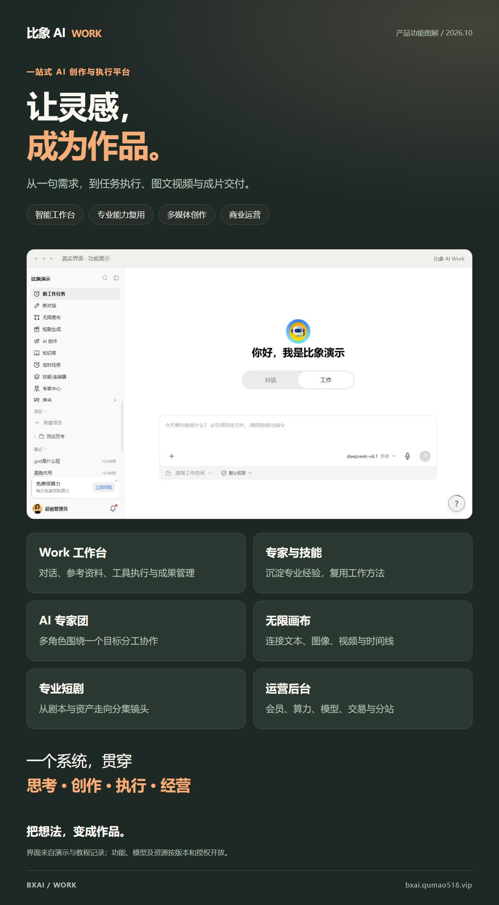

比象 AI Work 面向个人创作、内容团队与平台运营者，将模型对话、任务执行、专家技能、知识检索、多媒体创作、无限画布和短剧生产组织在同一个系统中。前台覆盖从资料整理、创意策划到图文视频交付的工作过程，配套后台负责用户、会员、模型、计费、内容、任务与分站运营。

**整个 Work 包的介绍分为三部分：Work 主工作台、配套创作模块、商业运营后台。** 主工作台包括对话、任务、专家、技能、专家团、知识库、连接器、定时任务、成果和分享；创作模块包括图片、视频、画布、专业短剧，以及按授权配置的音乐、音色、数字人、PPT、应用等能力；后台提供相应的资源配置、权限、商品交易和运营管理。

快速导航：[工作台](#1-work-工作台从一句需求到可交付成果) · [专家与技能](#2-专家与技能让经验成为可复用能力) · [专家团](#3-ai-专家团一个目标多角色分工) · [图片与视频](#4-图片与视频统一入口按模型开放参数) · [无限画布](#8-无限画布把文本图片视频与素材组织成创作流程) · [专业短剧](#9-短剧专业模式从剧本到分集镜头) · [技能商店](#14-技能与专家商店让专业能力成为可运营资产) · [完整后台](#商业运营后台完整功能清单) · [版本范围](#版本与交付范围)

**本系统为收费商业产品，需要授权。公开仓库用于产品展示与指定编译发行内容的分发，不代表系统源码开放，也不授予免费商用或转售权限。** 新版介绍与本仓库历史运行包不保证属于同一版本，部署、升级和购买请确认匹配版本与交付清单。

## 核心功能

| 核心能力 | 可以完成什么 |
| --- | --- |
| **Work 智能工作台** | 对话与工作双模式，结合参考文件、专家、技能和工具执行任务，查看过程与成果 |
| **专家与技能** | 将行业经验、工作方法和参考资料组织成可复用能力，创建自己的专家并维护技能版本 |
| **AI 专家团** | 按角色组织策划、研究、创作和检查，围绕同一目标分工，查看任务与交付成果 |
| **AI 图片与视频** | 统一创作入口，选择模型、引用素材、调整参数，管理生成记录和作品 |
| **无限画布与成片** | 以节点、连线、素材和时间线组织创作，结合画布助手、技能与成片流程制作作品 |
| **短剧专业模式** | 剧本创作或导入、角色场景与道具拆解、造型音色、分集分镜、镜头图视频和导出 |
| **知识库与外部工具** | 使用业务文档、知识检索、网页搜索及 MCP / HTTP 连接器，为任务补充资料和工具 |
| **定时执行** | 以一次性、固定间隔或 Cron 方式安排任务，查看运行历史 |
| **模型与费用控制** | 固定模型或选择智能调度策略，结合任务预算、费用和用量管理控制成本 |
| **素材与内容生态** | 提示词图库、个人资产、素材、作品分享、创作广场，以及按配置开放的课程与文章 |
| **技能与专家商店** | 资源发现、个人创建与发布，按站点配置提供解锁、购买和创作者运营 |
| **商业运营后台** | 管理用户、会员、套餐、订单、算力与站点内容，按授权开放 OEM 品牌与分站能力 |

### 1. Work 工作台：从一句需求到可交付成果

- **对话与工作双模式**：日常交流与工具执行分别适配不同任务。
- **资料随任务进入**：添加文档、图片等参考文件，选择专家、技能、知识库和连接器。
- **过程可查看**：查看进度、工具状态与审批请求，支持停止及按任务状态恢复。
- **成果可复用**：预览、下载和归档生成文件，围绕已有成果继续修改。
- **项目与历史管理**：整理会话和任务，方便回顾与复用上下文。

例如，整理新品推广方案时，从产品资料出发完成卖点提炼、内容选题、图文文案与执行清单，再按需调用图片、视频或文档工具。

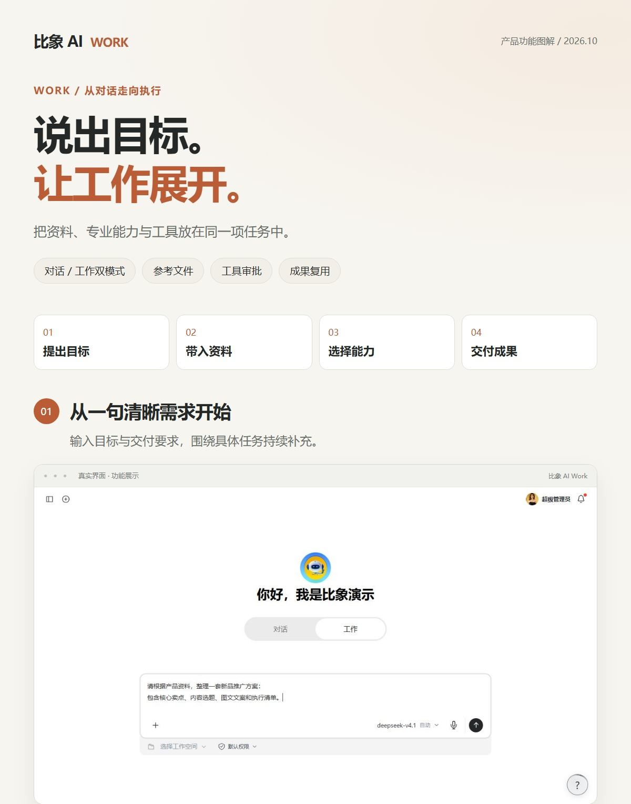

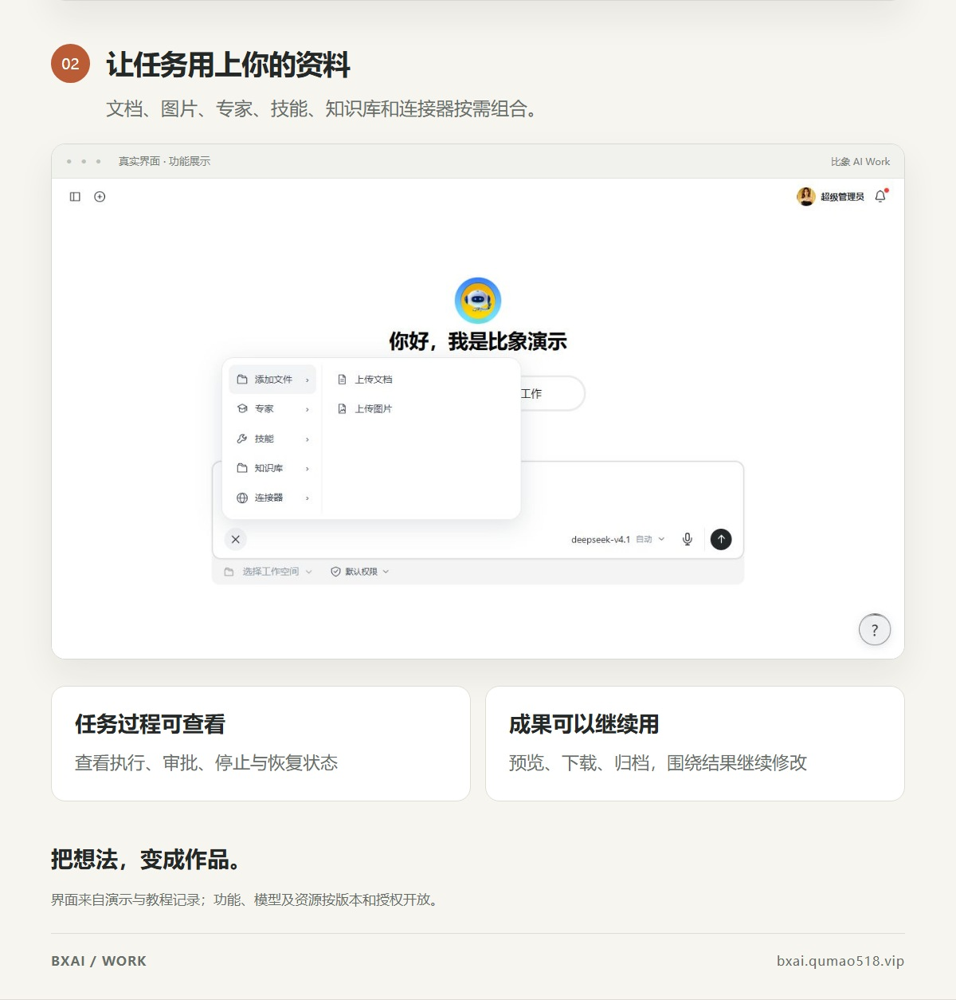

### 2. 专家与技能：让经验成为可复用能力

为不同业务选择或创建专家，将角色说明、技能指令、知识资料和工具组合起来，沉淀自己的工作方法。技能支持参考资料、配套文件与发布版本管理，方便在后续任务中重复调用。

适用于内容策划、品牌文案、电商运营、研究分析、编程辅助等场景。专家资源及具体内容以站点配置与所购清单为准。

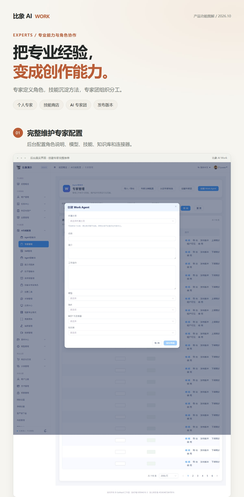

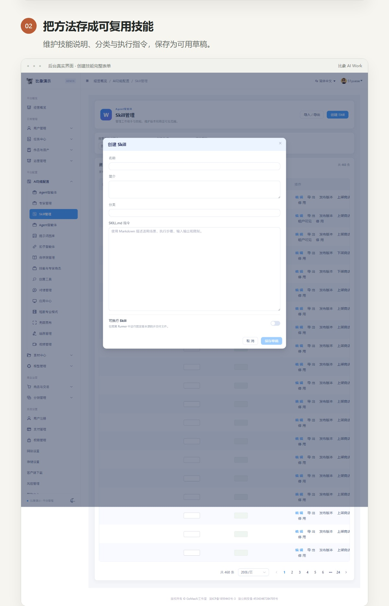

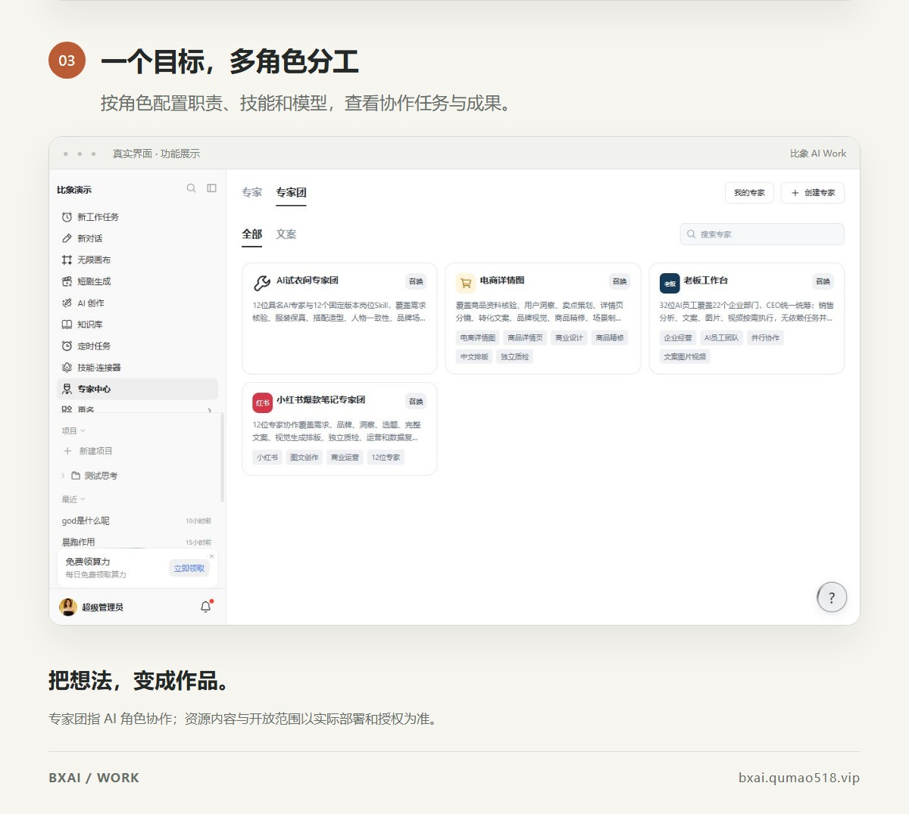

### 3. AI 专家团：一个目标，多角色分工

专家团以 AI 角色组织协作，为成员配置职责、技能与模型，围绕同一任务开展策划、执行和检查，并在过程中查看任务分工及成果。

演示界面包含电商详情图、小红书内容、老板工作台和 AI 试衣间等场景入口。具体专家团资源、执行能力及开放范围以部署版本、实际配置和授权为准。

> 专家团指 AI 角色协作。企业员工席位、组织权限与多人协作属于另外的产品范围，购买时需分别确认。

### 4. 图片与视频：统一入口，按模型开放参数

**图片创作**支持输入提示词、上传参考图片和选择可用模型；比例、分辨率、风格及编辑能力根据所选模型开放。

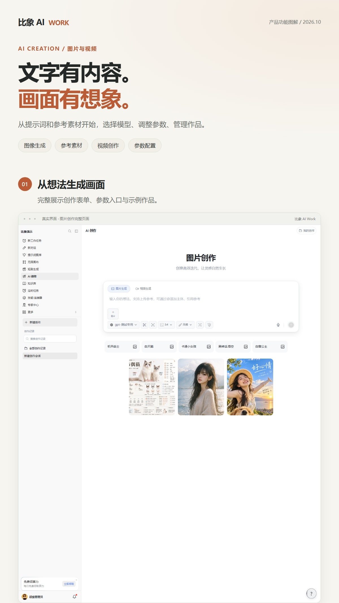

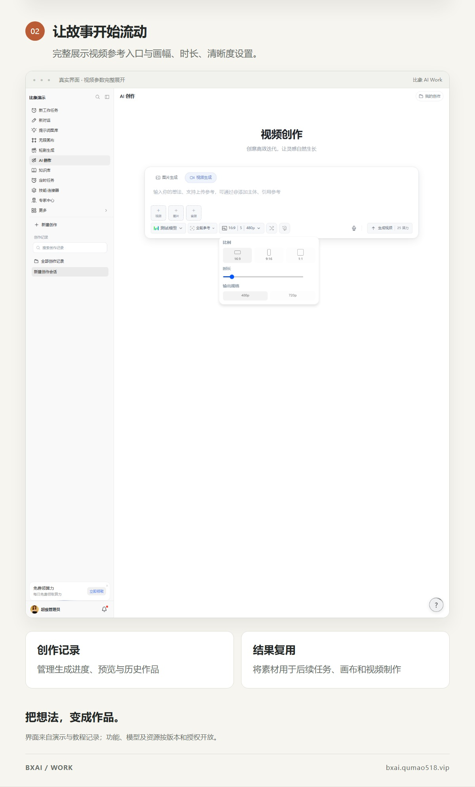

**视频创作**支持选择可用视频模型，按模型能力配置文生视频、参考素材、时长、画幅和清晰度等参数，并管理生成记录。

平台还提供音乐、语音、数字人、PPT、Word 文档、思维导图等相关创作模块。供应商、模型、在线编辑和导出能力，以所购版本、接口兼容情况与后台配置为准。

### 5. 知识库、连接器与定时任务

- **知识库**：维护业务资料与文档，在任务中检索和引用相关内容。
- **网页搜索与读取**：为研究和内容任务补充公开资料，搜索需配置相应服务。
- **MCP / HTTP 连接器**：连接外部工具，测试并发现工具后按权限启用。
- **定时任务**：设置一次性、固定间隔或 Cron 计划，查看执行状态和历史记录。

知识索引、外部接口和搜索服务需单独配置，工具可用范围受站点设置与任务权限约束。

### 6. 模型与智能调度：按任务选择，按预算执行

系统支持多模型接入。管理员配置并授权模型后，用户可以固定使用某个模型，或选择智能调度策略。

| 方式 | 选择依据 |
| --- | --- |
| 综合最优 | 综合成功率、速度、费用和可用容量 |
| 价格优先 | 优先选择费用较低的兼容模型 |
| 速度优先 | 按对话响应或媒体完成速度选择 |
| 成功率优先 | 参考近期调用表现选择 |
| 指定模型 | 仅使用选定模型，不自动换模型 |

任务可设置预算上限，结合预估费用、实际用量和执行状态管理成本。智能调度需部署配套版本并启用租户开关，切换仅适用于符合条件的失败。

**会员自定义 API**：符合站点会员条件的用户，可配置自己的模型接口并测试流式与工具兼容性。个人语言模型不扣平台对话算力，供应商费用自行承担；系统图片、视频等工具仍按平台规则计费。当前个人 API 不适用于专家团、定时任务和个人媒体模型。

### 7. 商业运营：前台创作，后台经营

- **用户与会员**：管理用户、会员类型、套餐和使用权益。
- **订单与算力**：支付订单、兑换码、用量与扣费规则，支付渠道按配置接入。
- **运营内容**：配置站点品牌、导航、首页推荐、内容和通知。
- **模型与工具**：维护模型接入、授权范围、费用及相关参数。
- **OEM 与分站**：按授权配置独立品牌、域名及分站经营能力。
- **邀请与活动**：按版本配置邀请奖励及相关运营功能。

适用于运营自有品牌的 AI 创作平台，或为客户提供约定范围内的授权部署服务。授权数量、域名、分站、可转售范围及售后服务需在交易前确认。

### 8. 无限画布：把文本、图片、视频与素材组织成创作流程

画布用节点和连线承载创作内容，将灵感、参考素材、文本、图片、视频和时间线放到同一个工作空间中，适合分镜策划、连续画面和多素材视频生产。

- **项目与节点**：创建画布项目，添加和连接不同类型的节点，组织素材与生成结果。
- **参考与资产复用**：引用角色、场景、图片等资料，围绕同一项目持续创作。
- **画布助手与 Skill**：结合任务要求和已开放技能推进创作，按配置选择手动或自动执行方式。
- **分镜与成片**：从创作要求或已有剧本出发配置分镜、图片与视频，使用时间线组织片段。
- **导演台与 AI 导演**：编排角色姿势、人物关系、道具、机位、灯光与构图，结合已配置的 AI 工具辅助镜头设计。
- **视频处理**：按工具配置使用视频增强、字幕擦除及裁剪等处理能力，也可将视频解析为故事与镜头参考。
- **保存与发布**：维护项目内容和历史，按开放权限预览、分享或发布作品。

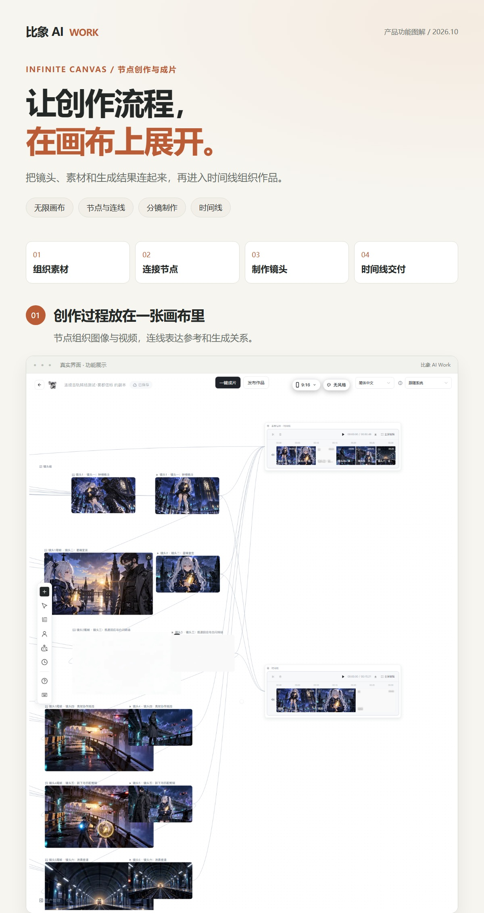

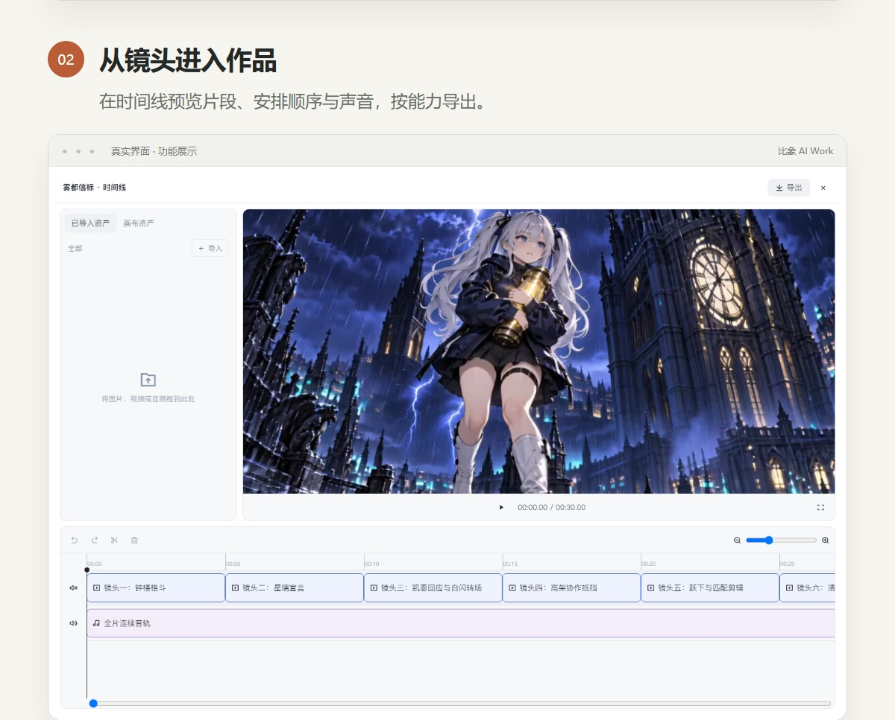

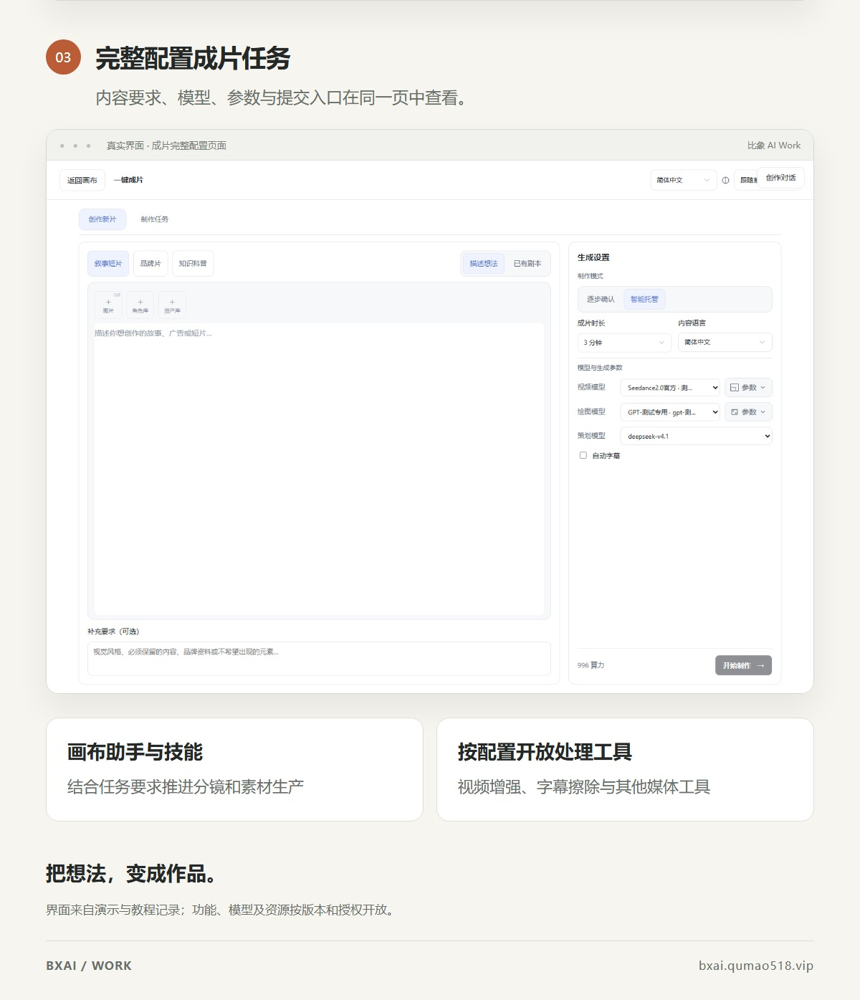

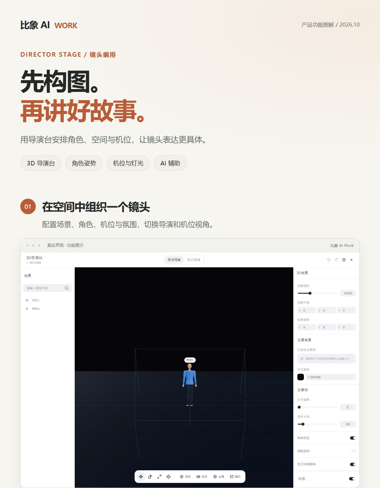

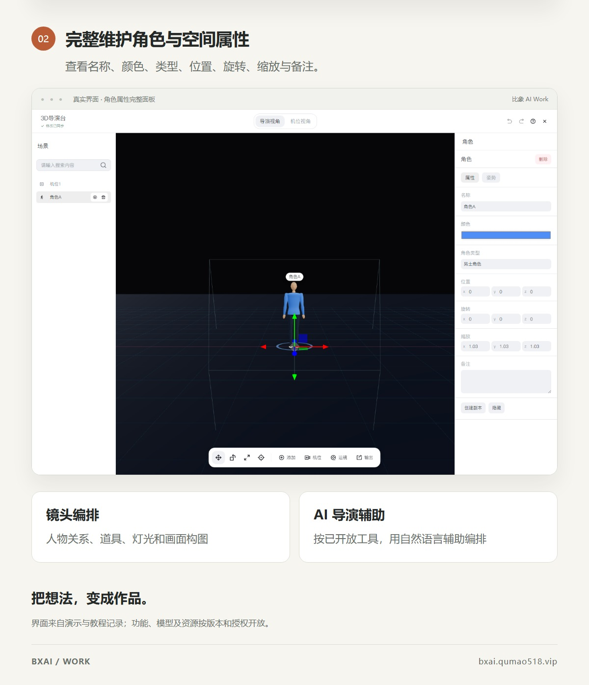

### 9. 短剧专业模式：从剧本到分集镜头

**短剧专业模式已接入 Work 工作台**，支持从上传剧本、粘贴文本或故事灵感开始，逐步管理全剧资产、剧集、分镜及镜头成果。

| 制作阶段 | 主要功能 |
| --- | --- |
| 创建作品 | 作品列表、画面比例、风格、自定义要求、模型配置、重命名与删除 |
| 剧本准备 | 上传剧本文件、粘贴文本、从灵感创作、编辑剧本和分析内容 |
| 全剧资产 | 拆解并维护角色、场景、生物和道具，编辑描述，上传或生成参考图 |
| 角色与造型 | 角色库、三视图、造型生成与上传、素材锁定及复用 |
| 场景与方位 | 维护场景描述和不同方位，引用场景素材组织镜头 |
| 音色与声音 | 角色音色选择、音色设计、克隆、试听，按模型能力配置配音 |
| 分集与分镜 | 分集剧本编辑、镜头分析、素材引用、首帧与视频生成 |
| 镜头制作 | 查看模型参数与进度，管理参考图、角色音色和生成结果 |
| 成果交付 | 预览、下载及视频打包导出，按所购版本开放相关合成能力 |

短剧助手可围绕作品、资产与剧集继续沟通，配合素材选择和费用提示推进生产。近期实现还围绕台词与说话人、人物造型、场景空间、镜头连续性和手动修改保留进行了改进，效果取决于输入资料及生成模型。

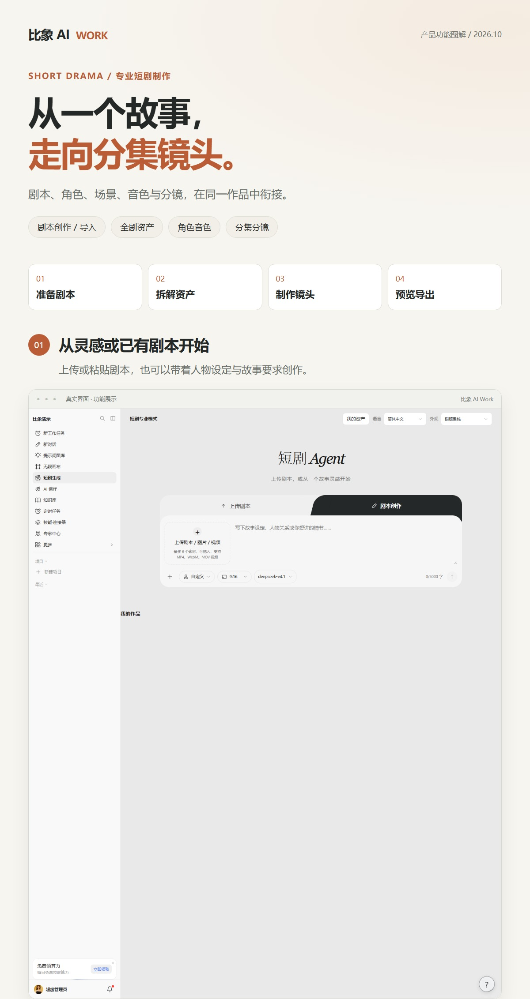

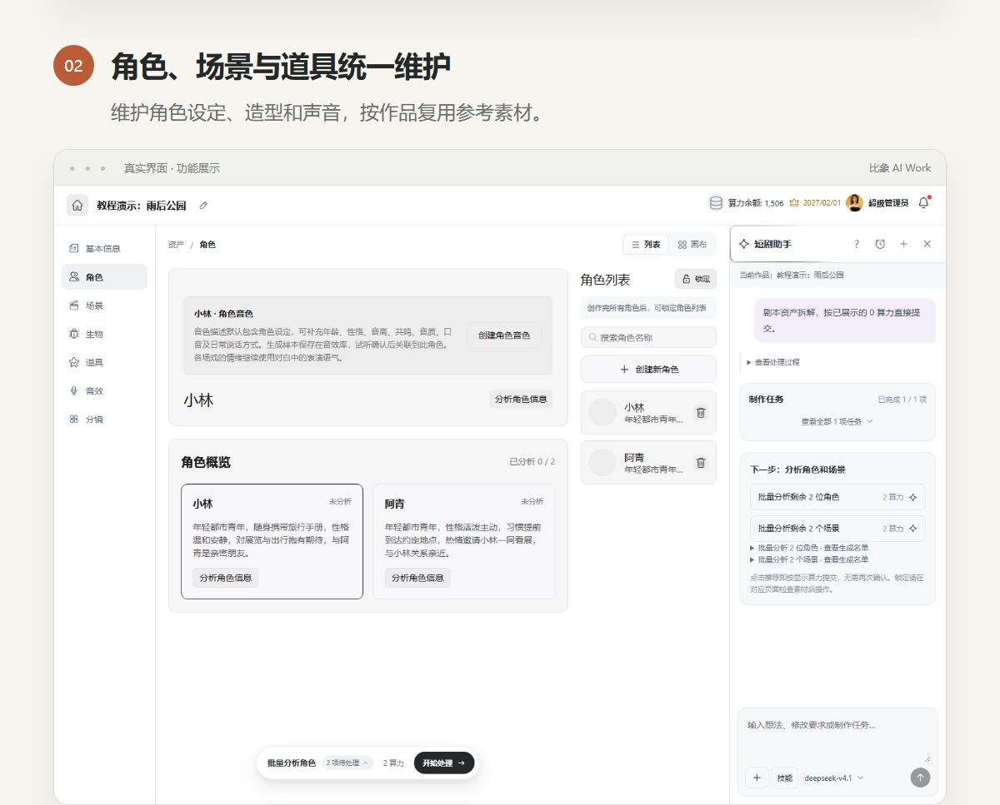

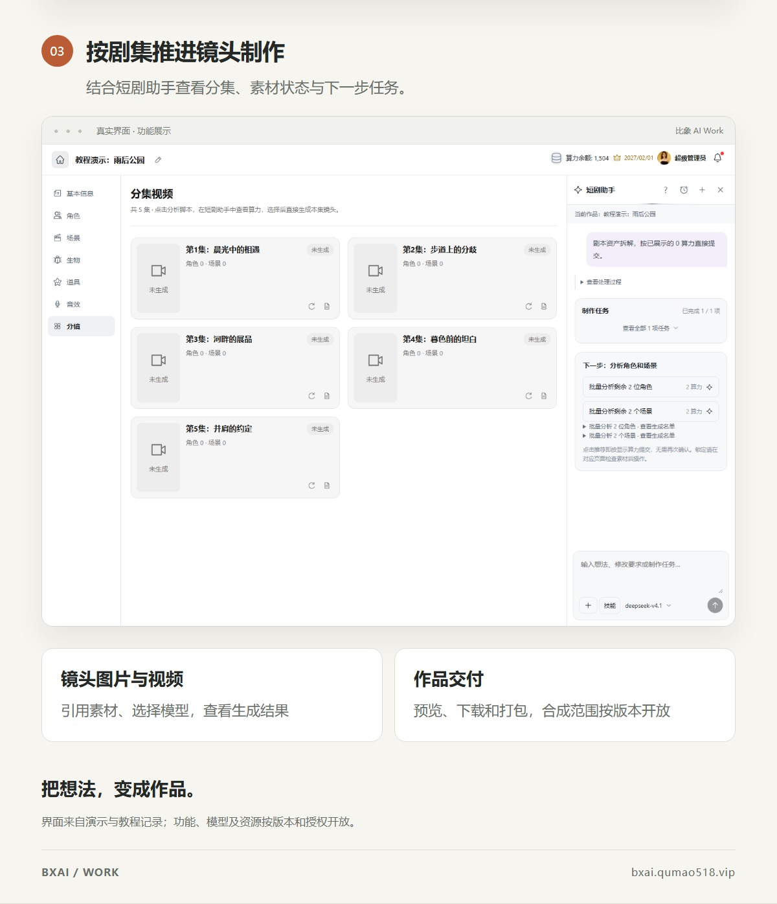

独立短剧包中的高效模式、小说素材等其他入口，不直接视为 Work 专业模式的相同交付范围。

### 10. 音乐、语音与音色

- **音乐创作**：围绕歌词、风格和歌曲要求生成音乐，查看作品并试听、下载；上传、延展等操作以模型支持范围为准。
- **语音合成**：选择公共或个人音色，按开放模型将文本转换为语音。
- **音色设计与克隆**：维护音色、上传或生成参考音频，试听后用于相应创作场景。
- **音频识别与处理**：通过已配置的识别模型或媒体工具处理音频输入。
- **业务计费**：音乐、歌词、音频或克隆能力分别按后台规则和供应商能力开放。

这些能力由配套模块或工具提供，Work 主创作页以图片与视频为主要入口，不将所有音频功能描述为同一页面的固定按钮。

### 11. 数字人与声音创作

配套数字人模块提供数字人市场、声音市场、数字人及声音克隆、作品合成和作品管理。按接口及授权范围维护素材，结合文字、音频等输入生成相关作品；后台可配置克隆、合成费用、会员次数、示例和市场资源。

数字人服务与授权、素材要求、音视频时长等由对应供应商及版本决定，需配置服务后使用。

### 12. PPT、文档、导图与办公成果

- **PPT**：从主题和大纲开始，结合模板或封面生成演示文稿，管理作品、收藏和下载；在线编辑以接口及部署版本为准。
- **文档**：利用工作任务或对应工具整理方案、报告、文案及其他文档成果。
- **思维导图**：将需求整理为结构化内容，按开放工具生成和导出导图。
- **代码与数据处理**：可执行技能在受控运行环境中调用 Python / JavaScript，辅助处理资料、数据或生成文件；依赖、权限与超时受平台配置约束。
- **成果管理**：通过成果面板预览、下载与继续使用可交付文件，导出格式以对应工具为准。

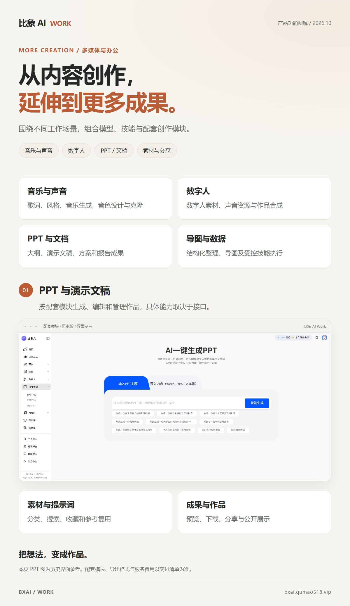

### 13. 创意工具、应用与智能体扩展

通过后台定义工具分类、表单字段、选项、提示词变量、返回类型及费用，将常用能力包装为可直接填写和执行的工具。

| 扩展类型 | 功能范围 |
| --- | --- |
| 创意工具 | 分类展示、动态输入表单、参考图片或视频、提示词辅助、执行结果与历史 |
| 媒体 AI 工具 | 按目录开放图像、视频及其他媒体处理能力，独立配置参数和计费 |
| 应用中心 | 维护应用分类、说明、模型和预设任务，按站点导航开放 |
| 应用工作流 | 维护应用专用技能与工作流版本，按开放节点填写内容并运行 |
| 外部智能体 | 通过已配置的扣子及其他兼容接口或连接器接入智能体、知识及工作流 |

应用专用技能与通用 Work 技能分别管理。旧版 Dify、FastGPT 等接入方式及入口是否包含在所购版本中，需要按当前接口配置确认。

### 14. 技能与专家商店：让专业能力成为可运营资产

用户可在资源中心查找技能与专家，管理“我的”和“已启用”内容，按任务需要组合专业能力。

- **资源使用**：浏览、搜索、选择和启用技能，查看说明和使用要求。
- **个人创建**：创建或编辑专家和技能，维护指令、参考资料及配套文件；也可通过工作助手辅助创建。
- **版本沉淀**：维护草稿与发布版本，将稳定的方法用于后续任务。
- **迁移与备份**：按权限导入、导出资源，导入后核对草稿再发布。
- **商店运营**：按部署版本配置免费、会员解锁或算力购买，配套资源审核及商品管理。
- **创作者业务**：服务需求、交付确认、退款期、收益、服务费及提现等扩展业务以实际启用的商业模块为准。

### 15. 知识库：把业务资料带入任务

用户可创建知识库，维护文本与文件资料，查看处理状态，在专家或任务中选择相应知识资源。后台可配置共享知识库、托管知识服务、检索模式、Embedding、重排和召回参数。

资料处理和检索依赖所配置的知识服务。不同资源的可见范围、版本及使用权限按用户和站点设置控制。

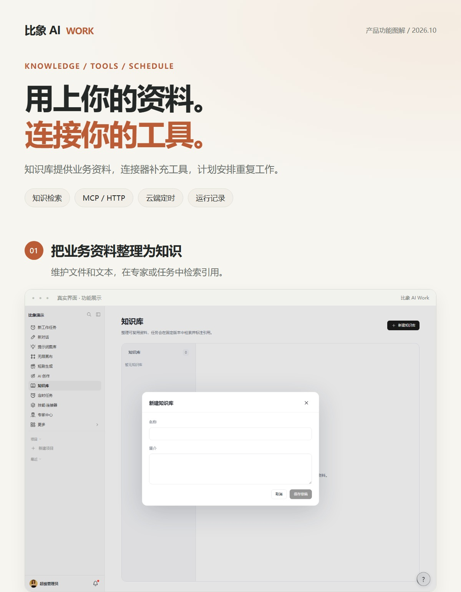

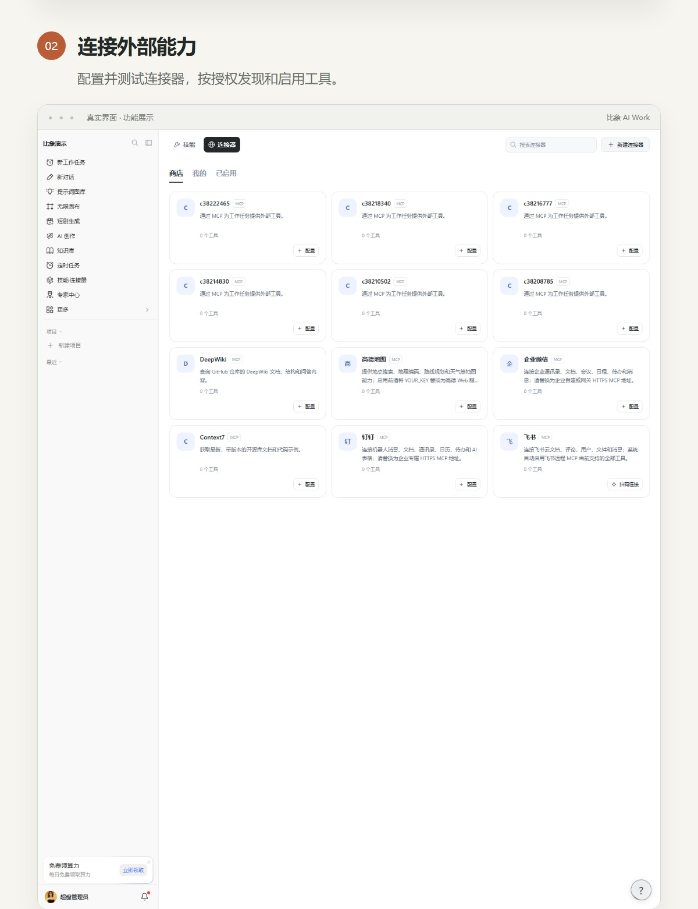

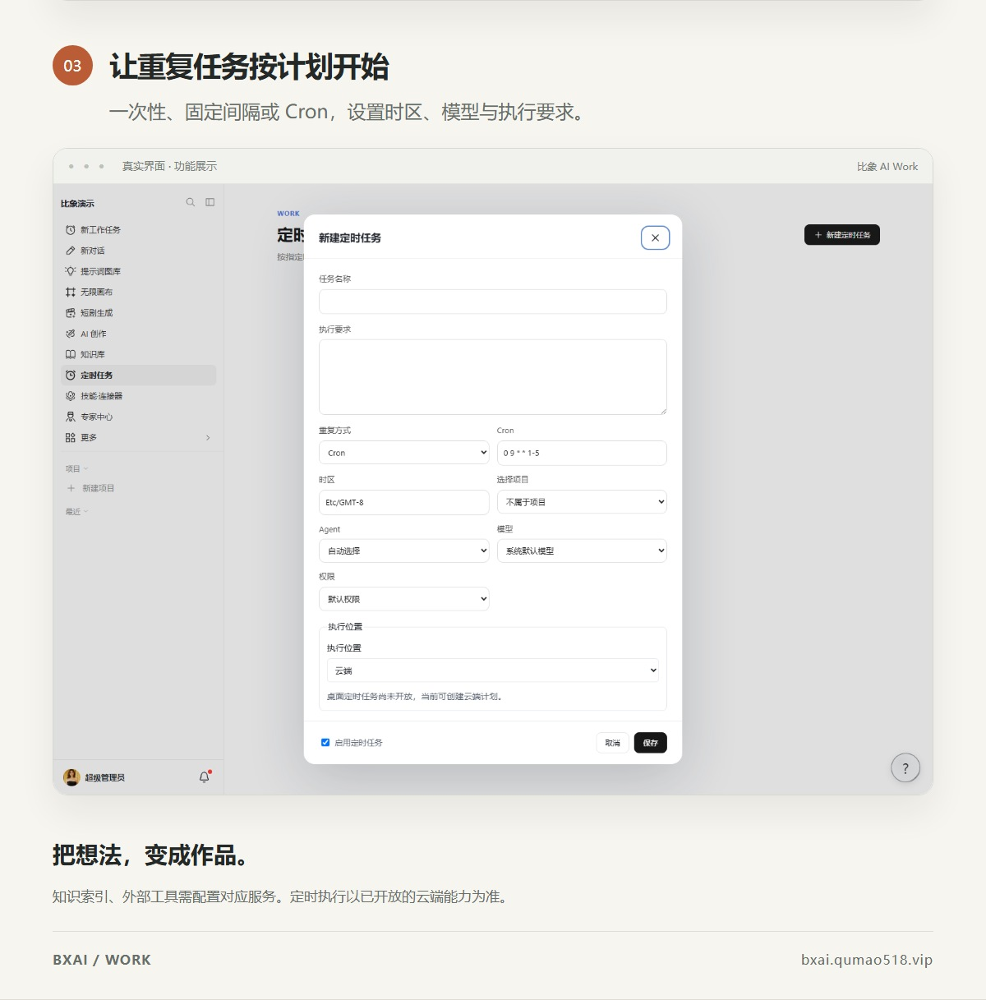

### 16. 连接器：让任务使用外部工具

管理员可维护共享 MCP / HTTP 连接器；普通用户可创建私有远程 MCP 连接器，配置、测试并选择工具，启用后供授权任务使用。

连接器中心可配置文档检索、地图和企业协作等类型的服务。飞书、钉钉、企业微信等连接范围由接入地址、账号授权和远端工具决定；预设卡片本身不代表已完成连接，也不代表所有工具都可用。

### 17. 定时任务：让重复工作按计划开始

- **时间方式**：一次性、固定间隔或 Cron，并设置时区。
- **任务配置**：填写要求，选择项目、专家、模型、技能及任务权限。
- **运行管理**：启用、停用计划，查看关联会话与执行记录。
- **典型场景**：周期资料汇总、内容选题、定期报告及其他已接入工具的重复任务。

当前介绍中的定时执行以云端任务为主。桌面定时执行仍有独立发布与验收要求，不能据配置界面认定其已开放。

### 18. 提示词图库、素材与个人资产

- **提示词图库**：浏览图片和视频示例，按模型、标签和关键词检索，将合适的提示词带入创作。
- **风格词库**：后台维护图片、视频、音乐及短剧相关的风格和推荐词。
- **素材库**：上传和分类管理参考素材，在画布、短剧或其他创作入口复用。
- **个人 AI 资产**：汇总专家、技能、知识库及所开放的数字人、音色等资源。
- **历史媒体**：筛选和预览历史图片、视频等结果，按权限管理记录。

图库入口、分类、数量和具体素材由站点配置决定，演示资源不作为固定数量承诺。

### 19. 会话、项目、成果与分享

Work 支持项目分组、会话命名、置顶、搜索、分页、批量管理与未读状态，方便长期整理不同主题的任务。

任务中的附件和成果可预览、下载、复用，并按对应入口查看版本或继续修改。支持对话与媒体成果分享，管理分享内容、公开展示和撤销；画布及其他作品的公开发布沿用各自权限与审核规则。

### 20. 账户、会员、算力与通知

- **注册登录**：按站点配置支持账号、邮箱、短信或微信等方式。
- **账户管理**：头像、昵称、联系方式和账号安全等个人设置。
- **会员权益**：查看会员状态、有效期、套餐及开放模型和功能。
- **算力账户**：余额、消耗、充值、兑换码、免费次数和相关流水。
- **邀请奖励**：按运营规则分享邀请、查看记录与奖励，分销业务按授权开放。
- **消息与公告**：公告阅读、未读提醒、指定用户系统通知和反馈入口。
- **帮助中心**：问题搜索、分类、协议政策、联系与售后说明。

### 21. 商学院、文章与作品广场

配套内容模块包括课程分类、课程详情、视频课时、讲师介绍、购买与访问权限、学习记录，以及文章分类和资讯阅读。

公开作品与广场按模块提供图片、视频、音乐或画布作品展示，配合收藏、精选、分类和审核。后台可维护轮播、封面、排序、上架、驳回及下架状态。

### 22. 多语言、主题与桌面客户端

Work 界面支持简体中文、繁体中文和英文，并提供浅色、深色及跟随系统的外观选择；页面、表单和主要工作入口适配窄屏使用。

桌面扩展包含授权本地工作区、本机或云端执行选择、文件读取与编辑、差异预览、写入确认、撤销、命令审批和本机个人模型等能力。桌面安装包、签名、平台适配与发布验收单独管理，**不将内测实现等同于正式跨平台交付**。

独立移动端、APP、小程序及下载二维码按所购版本开放，不承诺所有端具备完全相同的入口与执行能力。

## 商业运营后台完整功能清单

后台围绕“用户使用什么、资源如何配置、费用如何结算、异常如何处理”提供集中管理。

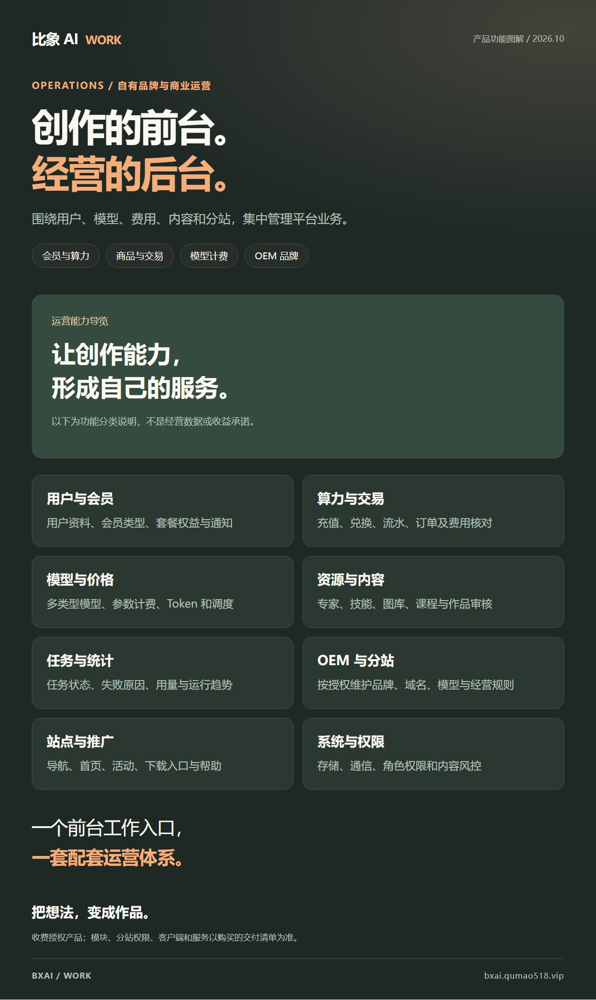

| 管理模块 | 主要内容 |
| --- | --- |
| 经营概览 | 用户增长、邀请、订单收入、任务量、算力消耗、余额及模型使用趋势 |
| 用户管理 | 查询、创建与批量创建、头像昵称和联系方式、状态、备注、上下级及来源记录 |
| 会员管理 | 会员类型、权益、套餐、有效期、赠送与调整、开通来源、个人 API 资格 |
| 算力与卡密 | 算力套餐、调整明细、账户流水、兑换码生成与管理 |
| 商品与交易 | 会员及算力商品、订单、支付结果核对、退款及异常处理 |
| 支付配置 | 按版本接入微信、支付宝或聚合支付等渠道，管理相应业务配置 |
| 分销与邀请 | 邀请奖励、分销规则与套餐、佣金、提现申请及审核 |
| OEM 分站 | 分站创建、管理员、初始经营算力、站点品牌、域名、授权模型、价格与结算 |
| 模型管理 | 对话、识图、应用、绘画、视频、音乐、音色、工具、PPT、扣子和数字人等目录 |
| 模型计费 | 按次、参数、时长或 Token 配置价格，维护输入、输出、缓存等计费项 |
| 调度与预算 | 租户开关、候选资格、策略、预算及用量核对，处理不确定结算状态 |
| 专家与专家团 | 分类、角色、职责、模型、技能、知识库和工具绑定，草稿及发布版本 |
| 技能管理 | 指令、参考资料、文件、导入导出、执行环境、依赖与超时 |
| 知识库管理 | 共享及用户资料、托管服务、索引状态和检索配置 |
| 连接器管理 | MCP / HTTP 接口、鉴权、工具发现、工具定义和启停 |
| 创意工具与应用 | 分类、动态字段、提示词变量、工作流版本、返回类型及运行记录 |
| 画布管理 | 功能开关、节点、模型、助手能力、Skill、分镜与成片参数 |
| 短剧管理 | 作品、剧本、角色场景、专业模式任务、提示模板、生成费用及异常记录 |
| 多媒体配置 | 图片视频、音乐音频、数字人及 PPT 的模型、资源、费用和会员次数 |
| 素材与图库 | 资源分类、提示词图库、风格、推荐词、素材维护与作品审核 |
| 内容与课程 | 文章、课程、课时、讲师、轮播、购买授权和学习记录 |
| 品牌与导航 | 名称、图标、介绍、首页、菜单、推荐、轮播、排序和多端显示 |
| 活动推广 | 活动横幅、首页弹窗、按钮、注册签到奖励及有效时间 |
| 客户端发布 | 下载入口、说明、安装包链接、APP 与小程序二维码 |
| 消息与反馈 | 公告、指定用户通知、业务结果提醒及意见反馈 |
| 任务中心 | 分类任务、实时与历史状态、提交内容、耗时、失败原因和媒体归档 |
| 财务与异常核对 | 用量、扣费、退款、供应商结果、OEM 结算及人工处理记录 |
| 系统配置 | 存储、短信、邮件、微信、协议、帮助、联系信息和内容风控 |
| 后台权限 | 管理角色、菜单和操作授权，以及后台语言和外观设置 |

企业团队会员、席位、发票、售后和高级财务流程属于独立授权模块，具体可用范围按版本和验收清单确认；AI 专家团不替代企业组织权限管理。

## 典型使用场景

| 场景 | 可以组合使用的能力 |
| --- | --- |
| 电商内容生产 | 产品资料 → 专家策划 → 卖点与详情文案 → 图片视频 → 成果交付 |
| 品牌与社交内容 | 知识库与参考 → 选题技能 → 图文脚本 → 多媒体 → 作品分享 |
| 短剧与视频制作 | 剧本 → 角色场景 → 造型音色 → 分集分镜 → 镜头图视频 → 导出 |
| 画布创作 | 灵感或素材 → 节点与连线 → 助手和技能 → 时间线 → 成片 |
| 办公与研究 | 文档与网页 → 检索整理 → 专家或技能 → 报告、PPT 与其他文件 |
| 自有品牌平台 | 品牌与域名 → 模型及定价 → 会员套餐 → 支付运营 → 任务与经营分析 |

## 版本与交付范围

| 范围 | 说明 |
| --- | --- |
| Work 主工作台 | 对话、任务、专家技能、专家团、知识库、连接器、定时、成果与资源入口，按授权启用 |
| Work 核心创作 | 图片、视频、无限画布和短剧专业模式，依赖对应模型与后台配置 |
| 配套模块 | 音乐、数字人、PPT、创意工具、应用、商学院等由所购模块及导航配置决定 |
| 运营与分站 | 会员算力、支付、内容、模型和任务后台；OEM 及其他商业扩展按授权开放 |
| 桌面与多端 | 客户端、平台适配、安装与更新服务以实际发行包和验收为准 |

本页按 10 个功能主题制作图解，并拆分为 21 张连续展示图；分段位置避开截图和表单。专家、技能、图片视频参数及导演台等界面按完整表单或完整面板展示，可点击放大查看。界面来自真实演示与教程记录，图中的说明文字为功能讲解；PPT 界面为历史参考，运营导览为功能分类设计。模型、素材、价格、示例内容和数量属于站点配置，不作为固定交付承诺。

本介绍覆盖当前 Work 包及相关配套能力，不代表所有能力均已在每个站点上线或完成真实供应商联调。发布与交付以实际版本、服务配置、授权及验收清单为准；介绍更新日期不作为安装包版本号。

## 部署与服务配置

| 部分 | 技术与依赖 |
| --- | --- |
| Web 与管理后台 | Vue 3 / TypeScript |
| 后端服务 | Node.js / NestJS |
| 数据与任务 | MySQL / Redis，按版本运行要求配置 |
| 文件存储 | 按版本配置本地或对象存储 |
| 模型与媒体 | 配置可用的对话、图片、视频及其他供应商接口 |
| 扩展服务 | 搜索、知识索引、连接器和受控执行环境按需配置 |

请使用对应授权版本的部署文档和运行包。升级前备份数据库与配置，确认前台、管理后台、后端及任务执行服务版本匹配；不要以本介绍替代部署和迁移说明。

## 商业授权与交付

1. **收费授权产品**：仓库公开可见不等于源码开源或免费商用，完整功能按商业授权提供。
2. **编译加密交付**：公开发行内容仅使用已核验的指定编译加密包，不公开系统核心源码、真实密钥、服务器配置或客户数据。
3. **交付范围明确**：模块、客户端、专家与技能资源、OEM 权限、安装服务和更新支持，以购买的交付清单为准。
4. **第三方费用另计**：模型接口、媒体生成、服务器、域名、存储及其他外部服务费用由使用方承担。
5. **版本与能力对应**：新版介绍不意味着仓库历史运行文件已同步升级，请获取与授权、配置和数据库结构匹配的正式发行包。

**在线体验**：[比象 AI 演示站](https://bxai.qumao518.vip)

**授权咨询**：微信 `lzgzs168` · QQ `124628086`

---

比象 AI Work：让对话、专业经验与创作工具，围绕你的下一件作品协同工作。
