

# 比象 AI Work · AI 全能创作与智能工作台

### 把想法，变成作品。让 AI 从对话走向任务执行。

智能对话 · 专家与技能 · AI 专家团 · 图片与视频 · 知识库与工具 · 商业运营

[在线体验](https://bxai.qumao518.vip) · [核心功能](#核心功能) · [商业授权](#商业授权与交付)

**产品介绍更新：2026 年 10 月 19 日**

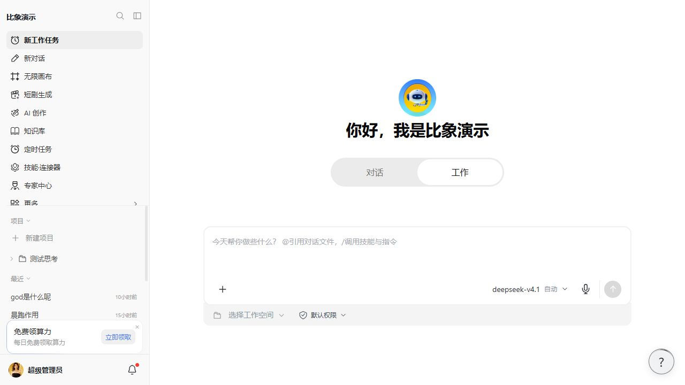

比象 AI Work 面向个人创作、内容团队与平台运营者，将模型对话、任务执行、专家技能、知识检索和多媒体创作集中到同一个工作入口。围绕一个目标，引用资料、选择专家、调用工具、查看进度，再将成果预览、下载和复用。

**本系统为收费商业产品，需要授权。公开仓库用于产品展示与指定编译发行内容的分发，不代表系统源码开放，也不授予免费商用或转售权限。** 新版介绍与本仓库历史运行包不保证属于同一版本，部署、升级和购买请确认匹配版本与交付清单。

## 核心功能

| 核心能力 | 可以完成什么 |
| --- | --- |
| **Work 智能工作台** | 对话与工作双模式，结合参考文件、专家、技能和工具执行任务，查看过程与成果 |
| **专家与技能** | 将行业经验、工作方法和参考资料组织成可复用能力，创建自己的专家并维护技能版本 |
| **AI 专家团** | 按角色组织策划、研究、创作和检查，围绕同一目标分工，查看任务与交付成果 |
| **AI 图片与视频** | 统一创作入口，选择模型、引用素材、调整参数，管理生成记录和作品 |
| **知识库与外部工具** | 使用业务文档、知识检索、网页搜索及 MCP / HTTP 连接器，为任务补充资料和工具 |
| **定时执行** | 以一次性、固定间隔或 Cron 方式安排任务，查看运行历史 |
| **模型与费用控制** | 固定模型或选择智能调度策略，结合任务预算、费用和用量管理控制成本 |
| **商业运营后台** | 管理用户、会员、套餐、订单、算力与站点内容，按授权开放 OEM 品牌与分站能力 |

### 1. Work 工作台：从一句需求到可交付成果

- **对话与工作双模式**：日常交流与工具执行分别适配不同任务。
- **资料随任务进入**：添加文档、图片等参考文件，选择专家、技能、知识库和连接器。
- **过程可查看**：查看进度、工具状态与审批请求，支持停止及按任务状态恢复。
- **成果可复用**：预览、下载和归档生成文件，围绕已有成果继续修改。
- **项目与历史管理**：整理会话和任务，方便回顾与复用上下文。

例如，整理新品推广方案时，从产品资料出发完成卖点提炼、内容选题、图文文案与执行清单，再按需调用图片、视频或文档工具。

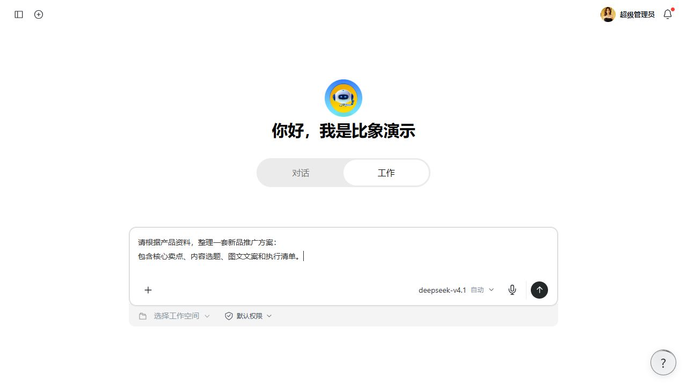

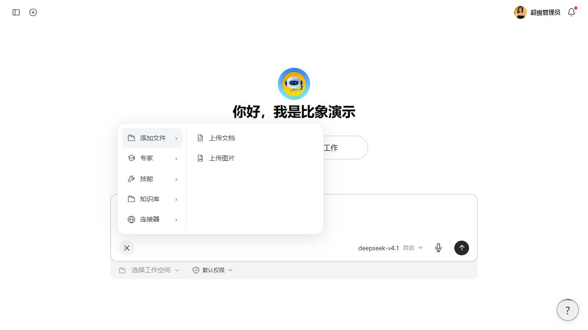

### 2. 专家与技能：让经验成为可复用能力

为不同业务选择或创建专家，将角色说明、技能指令、知识资料和工具组合起来，沉淀自己的工作方法。技能支持参考资料、配套文件与发布版本管理，方便在后续任务中重复调用。

适用于内容策划、品牌文案、电商运营、研究分析、编程辅助等场景。专家资源及具体内容以站点配置与所购清单为准。

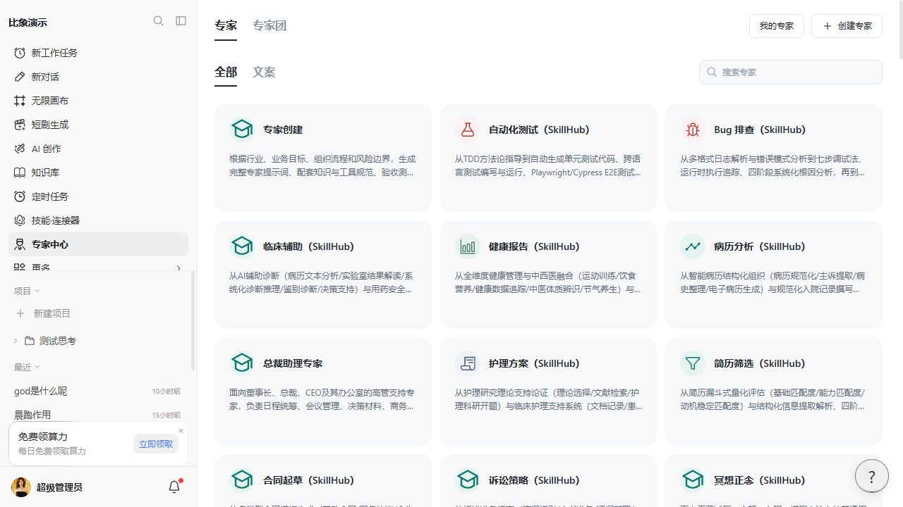

### 3. AI 专家团：一个目标，多角色分工

专家团以 AI 角色组织协作，为成员配置职责、技能与模型，围绕同一任务开展策划、执行和检查，并在过程中查看任务分工及成果。

演示界面包含电商详情图、小红书内容、老板工作台和 AI 试衣间等场景入口。具体专家团资源、执行能力及开放范围以部署版本、实际配置和授权为准。

> 专家团指 AI 角色协作。企业员工席位、组织权限与多人协作属于另外的产品范围，购买时需分别确认。

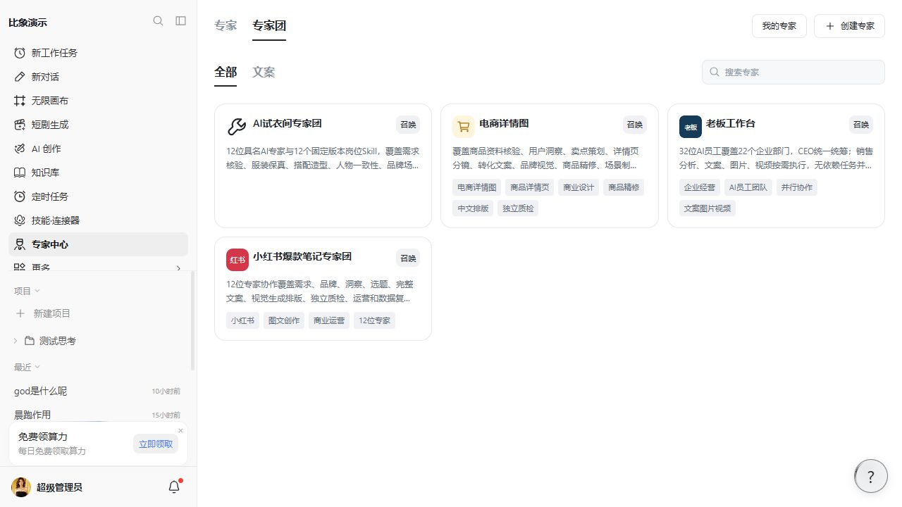

### 4. 图片与视频：统一入口，按模型开放参数

**图片创作**支持输入提示词、上传参考图片和选择可用模型；比例、分辨率、风格及编辑能力根据所选模型开放。

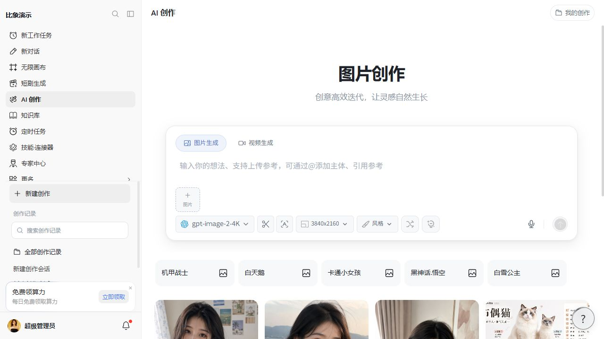

**视频创作**支持选择可用视频模型，按模型能力配置文生视频、参考素材、时长、画幅和清晰度等参数，并管理生成记录。

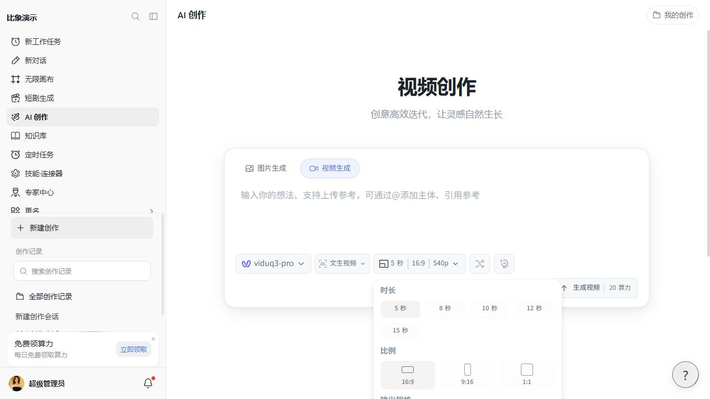

平台还提供音乐、语音、数字人、PPT、Word 文档、思维导图等相关创作模块。供应商、模型、在线编辑和导出能力，以所购版本、接口兼容情况与后台配置为准。

### 5. 知识库、连接器与定时任务

- **知识库**：维护业务资料与文档，在任务中检索和引用相关内容。
- **网页搜索与读取**：为研究和内容任务补充公开资料，搜索需配置相应服务。
- **MCP / HTTP 连接器**：连接外部工具，测试并发现工具后按权限启用。
- **定时任务**：设置一次性、固定间隔或 Cron 计划，查看执行状态和历史记录。

知识索引、外部接口和搜索服务需单独配置，工具可用范围受站点设置与任务权限约束。

### 6. 模型与智能调度：按任务选择，按预算执行

系统支持多模型接入。管理员配置并授权模型后，用户可以固定使用某个模型，或选择智能调度策略。

| 方式 | 选择依据 |
| --- | --- |
| 综合最优 | 综合成功率、速度、费用和可用容量 |
| 价格优先 | 优先选择费用较低的兼容模型 |
| 速度优先 | 按对话响应或媒体完成速度选择 |
| 成功率优先 | 参考近期调用表现选择 |
| 指定模型 | 仅使用选定模型，不自动换模型 |

任务可设置预算上限，结合预估费用、实际用量和执行状态管理成本。智能调度需部署配套版本并启用租户开关，切换仅适用于符合条件的失败。

**会员自定义 API**：符合站点会员条件的用户，可配置自己的模型接口并测试流式与工具兼容性。个人语言模型不扣平台对话算力，供应商费用自行承担；系统图片、视频等工具仍按平台规则计费。当前个人 API 不适用于专家团、定时任务和个人媒体模型。

### 7. 商业运营：前台创作，后台经营

- **用户与会员**：管理用户、会员类型、套餐和使用权益。
- **订单与算力**：支付订单、兑换码、用量与扣费规则，支付渠道按配置接入。
- **运营内容**：配置站点品牌、导航、首页推荐、内容和通知。
- **模型与工具**：维护模型接入、授权范围、费用及相关参数。
- **OEM 与分站**：按授权配置独立品牌、域名及分站经营能力。
- **邀请与活动**：按版本配置邀请奖励及相关运营功能。

适用于运营自有品牌的 AI 创作平台，或为客户提供约定范围内的授权部署服务。授权数量、域名、分站、可转售范围及售后服务需在交易前确认。

## 真实界面与扩展模块

本文新增的 Work、专家、专家团、图片及视频截图来自演示站真实界面，素材整理于 2026 年 10 月。截图中的模型、专家内容、价格和菜单属于演示配置，可随站点设置变化。

画布、短剧、多媒体扩展和不同客户端按版本与授权提供。演示站出现相关入口不代表所有交付均包含这些模块，各端能力以实际交付为准。

其他创作模块界面（历史版本参考）

以下为仓库已有截图，保留供了解模块类型；当前界面请以在线演示为准。

**数字人**

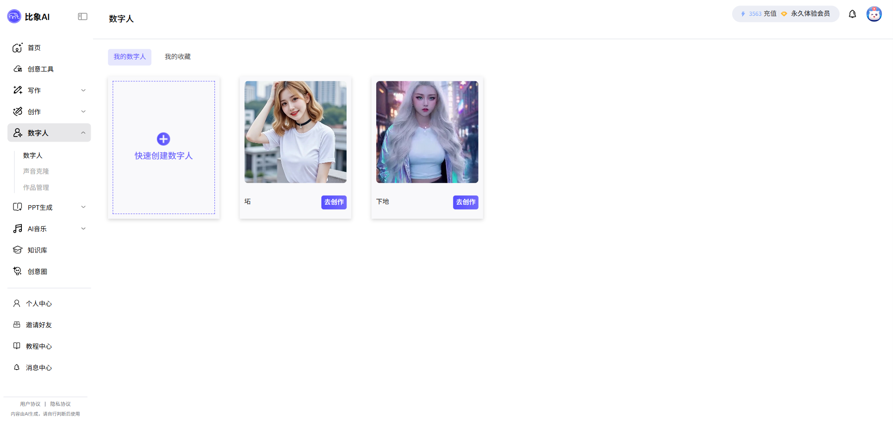

**PPT 生成**

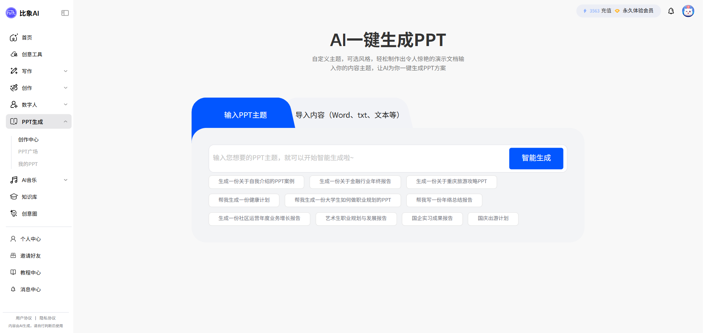

**音乐创作**

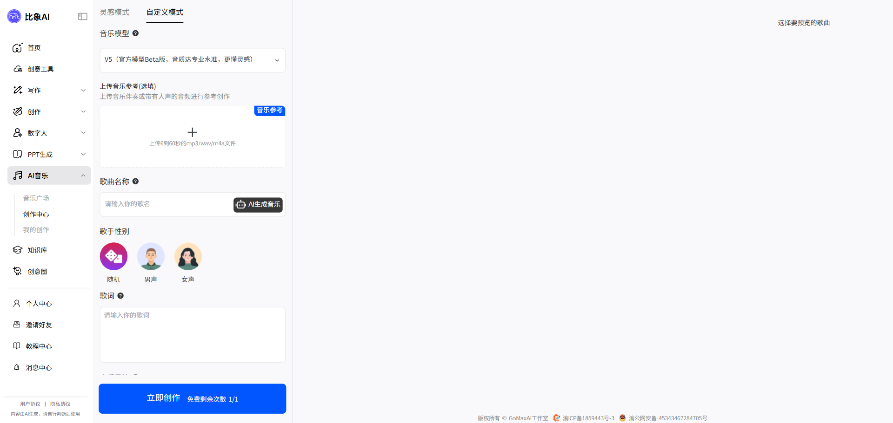

**管理后台**

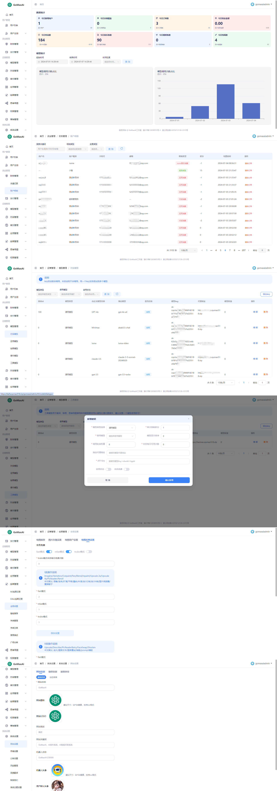

## 本次介绍更新

本次按当前 Work 产品形态重新整理展示内容，重点补充：

- 对话与工作双模式、参考文件、工具调用和成果交付。
- 专家、技能与 AI 专家团的业务场景及真实界面。
- 图片与视频的直接创作入口及模型参数配置。
- 知识库、外部工具连接器与定时执行。
- 固定模型、智能调度、任务预算和会员自定义 API。
- 会员、算力、订单、品牌与 OEM 商业运营能力。

本日期为介绍文档更新日期，不作为安装包版本号或全量发行记录。功能可用性以实际部署、服务配置与授权清单为准。

## 部署与服务配置

| 部分 | 技术与依赖 |
| --- | --- |
| Web 与管理后台 | Vue 3 / TypeScript |
| 后端服务 | Node.js / NestJS |
| 数据与任务 | MySQL / Redis，按版本运行要求配置 |
| 文件存储 | 按版本配置本地或对象存储 |
| 模型与媒体 | 配置可用的对话、图片、视频及其他供应商接口 |
| 扩展服务 | 搜索、知识索引、连接器和受控执行环境按需配置 |

请使用对应授权版本的部署文档和运行包。升级前备份数据库与配置，确认前台、管理后台、后端及任务执行服务版本匹配；不要以本介绍替代部署和迁移说明。

## 商业授权与交付

1. **收费授权产品**：仓库公开可见不等于源码开源或免费商用，完整功能按商业授权提供。
2. **编译加密交付**：公开发行内容仅使用已核验的指定编译加密包，不公开系统核心源码、真实密钥、服务器配置或客户数据。
3. **交付范围明确**：模块、客户端、专家与技能资源、OEM 权限、安装服务和更新支持，以购买的交付清单为准。
4. **第三方费用另计**：模型接口、媒体生成、服务器、域名、存储及其他外部服务费用由使用方承担。
5. **版本与能力对应**：新版介绍不意味着仓库历史运行文件已同步升级，请获取与授权、配置和数据库结构匹配的正式发行包。

**在线体验**：[比象 AI 演示站](https://bxai.qumao518.vip)

**授权咨询**：微信 `lzgzs168` · QQ `124628086`

---

比象 AI Work：让对话、专业经验与创作工具，围绕你的下一件作品协同工作。
